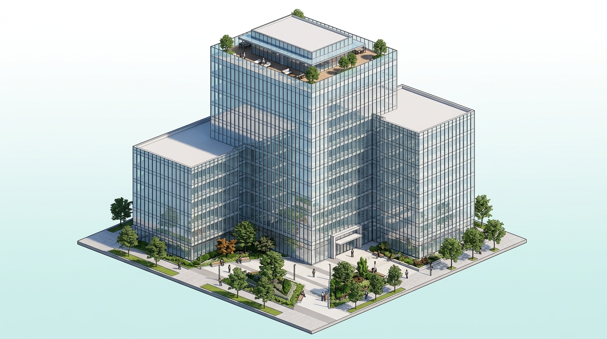

# PHP Float Glass Industries Limited — Interactive Website Showcase

A modern, interactive frontend showcase for **PHP Float Glass Industries Limited**, a concern of PHP Family in Chattogram, Bangladesh.



## 🌟 Key Highlights & Features

- **Section 1: Clear Glass Hero**
  - Realistic clear glass slab with gentle 3D perspective mouse-tilt and scroll-driven light sweeps.
- **Section 2: Reflective Glass Building Visualizer**
  - Isometric 3D glass building with **10 real catalogue reflective glass shades**:
    - Ocean Blue (`#1e88e5`)
    - Ford Blue (`#0d47a1`)
    - Royal Blue (`#2962ff`)
    - French Green (`#00897b`)
    - Dark Green (`#004d40`)
    - Euro Bronze (`#6d4c41`)
    - Golden Bronze (`#bf8d30`)
    - Euro Grey (`#546e7a`)
    - Dark Grey (`#263238`)
    - Silver (`#78909c`)
  - **Isolated Glass Recoloring**: Recolors *strictly* the building curtain wall facades without affecting the surrounding plaza, walkways, trees, roof deck, or sky.
- **Section 3: Decorative Glass Room**
  - Isometric 3D living room cutaway with 7 photo-texture swatches and light bounce effects.
- **Section 4: Interior Elegance Apartment Cutaway**
  - Multi-zone interior cutaway with dynamic leader lines and live state synchronization linked to the selections in Sections 2 & 3.
- **Product Portfolios & Specs**
  - Comprehensive catalogs for Clear, Reflective, Tempered, Decorative, Mirror, and Insulating glass.
  - PHP Aluminium profiles and special products (PHP Doors, Ladders, Gas Stoves).

## 🚀 How to Run Locally

You can run this project with any local HTTP server:

```bash
# Using Python
python -m http.server 8080

# Or with Node
npx serve .
```

Open `http://localhost:8080/index_v2.html` (Enhanced isolated glass visualizer) or `http://localhost:8080/index.html`.

## 📁 Project Structure

```
├── assets/
│   └── images/
│       ├── shades/                 # 10 pre-rendered reflective glass building shades
│       ├── building_glass_mask.png # High-precision architectural glass mask
│       └── ...                     # Product images and isometric renders
├── css/
│   ├── base.css
│   ├── components.css
│   ├── pages.css
│   ├── scenes.css
│   ├── scenes_v2.css
│   └── variables.css
├── js/
│   ├── data.js                     # Product data, colors & specs
│   ├── main.js                     # Core application logic & UI bindings
│   ├── router.js                   # Client-side hash routing
│   ├── scenes.js                   # Interactive 3D scene engine
│   ├── scenes_v2.js                # Enhanced scene engine with glass isolation
│   └── state.js                    # Reactive state store
├── index.html                      # Original showcase
├── index_v2.html                   # Enhanced isolated glass showcase
├── PHP Glass Website brief.pdf     # Project brief and specifications
└── README.md
```

---
*PHP Family — "Peace, Happiness and Prosperity"*
